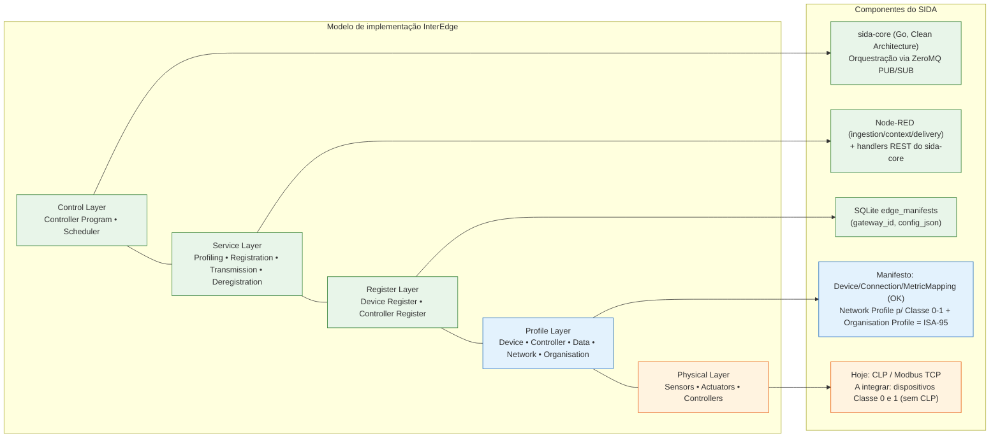
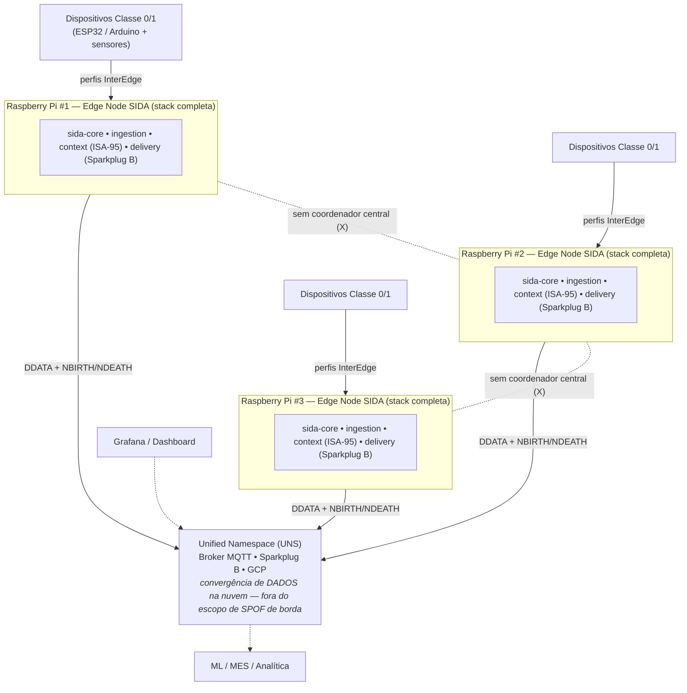
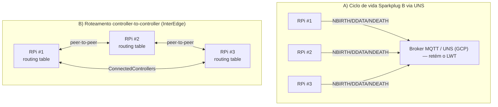
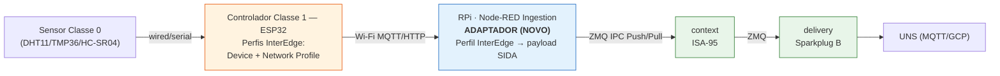
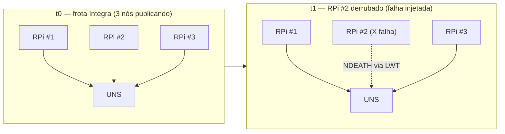

# Plano de Projeto Experimental — SENAI / Centro de Competência em Indústria Digital

> **Observação de uso:** este arquivo é a versão de trabalho (Markdown) do projeto, pensada para
> reaproveitamento como contexto em outras conversas e no Claude Code. Os diagramas estão em
> Mermaid para serem renderizáveis e portáveis. Existe também uma versão `.docx`/`.pdf` no formato
> SENAI com os mesmos conteúdos e diagramas em alta resolução.

## Identificação do projeto

- **Candidato:** Jackson Raniel Florencio da Silva
- **Desafio (D1, D2 ou D3):** D1
- **Título do Projeto:** Arquitetura de ingestão distribuída e resiliente para o SIDA: eliminação de ponto único de falha na borda mediante frota descentralizada e integração de dispositivos de recursos restritos via framework InterEdge
- **Área tecnológica predominante:** automação e interoperabilidade

### Resumo Executivo

O middleware de borda **SIDA (Smart Industrial DataOps Agent)** já validou empiricamente, em sua Release 2.0, um pipeline industrial ponta a ponta: ingestão de dados na borda, contextualização semântica segundo a norma **ISA-95** e entrega de payloads **Sparkplug B** a um broker MQTT em nuvem, organizando a informação como um **Unified Namespace (UNS)**. Contudo, sua topologia atual concentra a coleta em um gateway de borda único, configurando um **ponto único de falha (SPOF — Single Point of Failure)**, e sua camada de ingestão reconhece apenas o protocolo Modbus TCP, deixando descobertos contextos industriais sem CLPs ou com instabilidade de rede local.

Este projeto propõe reprojetar a camada de ingestão do SIDA em **duas etapas**, fundamentado no modelo de interoperabilidade hierárquico e descentralizado **InterEdge**. A primeira etapa distribui o SIDA em uma **frota de gateways Raspberry Pi** que convergem em um UNS compartilhado, **sem nó central de coordenação na borda** — eliminando o SPOF de borda. A segunda etapa habilita **dispositivos de recursos restritos (Classe 0 e 1)** como novas fontes de ingestão, no estilo dos perfis InterEdge. O projeto inclui ainda a **investigação formal do mecanismo de coordenação** descentralizada entre os gateways e o **mapeamento arquitetural** entre o framework InterEdge e os componentes já implementados do SIDA — posicionando o SIDA como a primeira realização concreta do **nível organizacional** do modelo, até hoje não implementado. A metodologia adotada é a **Design Science Research (DSR)**, e a meta central (eliminação do SPOF de borda) é avaliada por **teste de injeção de falha**.

---

## 1. Contexto e problema a ser resolvido

A interoperabilidade é condição necessária para o sucesso da Internet das Coisas Industrial (IIoT) e para a concretização da Indústria 4.0 (AMJAD, 2021; BURNS, 2019). Em ambientes *brownfield*, ativos legados falam protocolos proprietários e fornecem dados sem contexto semântico, criando silos de informação. Soluções de interoperabilidade tradicionais dependem, com frequência, de arquiteturas centralizadas baseadas em nuvem, que introduzem latência e fragilidade em cenários sensíveis ao tempo e sujeitos a instabilidade de rede (AZAD, 2025).

O projeto SIDA endereça esse problema como um middleware de borda que ingere dados brutos, aplica a modelagem hierárquica ISA-95 (Empresa/Planta/Área/Linha/Equipamento) e publica informação estruturada em um Unified Namespace via MQTT/Sparkplug B. A Release 2.0 entregou um MVP funcional, com arquitetura de microsserviços poliglota (sida-core em Go com framework Gin e Clean Architecture; serviços de ingestão, contexto e entrega em Node-RED), comunicação interna por ZeroMQ e persistência de manifestos em SQLite. Sobre essa base consolidada, três lacunas concretas motivam o presente projeto.

### 1.1. Ponto único de falha na borda (SPOF)

Na topologia atual, o `sida-core` orquestra a coleta e a configuração de toda a sua abrangência. Uma instância única de borda concentra a responsabilidade pela ingestão, de modo que sua indisponibilidade interrompe a coleta de todos os ativos sob seu domínio. Essa fragilidade já foi identificada, na formulação original do desafio, como um obstáculo crítico à resiliência operacional.

### 1.2. Cobertura restrita de fontes de ingestão

A camada de ingestão do SIDA, em sua Release 2.0, implementa apenas **Modbus TCP** — limitação registrada explicitamente entre as limitações conhecidas da release. Ambientes industriais sem CLPs, ou com sensoriamento distribuído sobre dispositivos de baixa capacidade, ficam fora do alcance do sistema. Dispositivos de recursos restritos (**Classe 0**, como o Arduino Uno R3, e **Classe 1**, como o ESP32) poderiam alimentar a ingestão, mas o SIDA não dispõe hoje de mecanismo para integrá-los.

### 1.3. Lacuna teórica: o nível organizacional do InterEdge

O framework **InterEdge** — modelo hierárquico descentralizado de interoperabilidade em borda que fundamenta academicamente este trabalho — define quatro níveis: **rede, sintático, semântico e organizacional**. Os trabalhos que o implementaram realizaram os níveis de rede (AZAD, 2025) e sintático/semântico (AZAD et al., 2025), mas ambos declaram explicitamente que o **nível organizacional nunca foi implementado**, por estar fora do escopo daqueles estudos. O SIDA, ao aplicar contextualização hierárquica ISA-95, executa precisamente o tipo de trabalho organizacional que esse nível descreve, abrindo espaço para uma contribuição original.

> **Problema a ser resolvido:** como tornar a camada de ingestão do SIDA **distribuída e resiliente** — eliminando o SPOF de borda — e simultaneamente **ampliá-la para fontes de recursos restritos**, fundamentando essa evolução no modelo InterEdge e formalizando a relação entre os dois.

---

## 2. Objetivos

### Objetivo geral

Projetar e validar uma arquitetura de ingestão distribuída e resiliente para o middleware SIDA que **elimine o ponto único de falha na camada de borda**, por meio de uma frota descentralizada de gateways coordenados sem nó central e da integração de dispositivos de recursos restritos (Classe 0 e 1) como fontes de ingestão, fundamentada no modelo de interoperabilidade InterEdge.

### Objetivos específicos

1. **Formalizar o mapeamento arquitetural** entre as camadas do framework InterEdge e os componentes já implementados do SIDA, identificando e posicionando o nível organizacional (via ISA-95) como contribuição concreta.
2. **Investigar e selecionar**, segundo critérios definidos, o mecanismo de coordenação descentralizada entre os gateways SIDA da frota (ciclo de vida Sparkplug B via UNS versus roteamento *controller-to-controller* do InterEdge).
3. **Implementar a frota descentralizada** em múltiplos Raspberry Pi, cada um executando a pilha completa do SIDA e publicando em um UNS compartilhado, sem nó central de coordenação na borda.
4. **Implementar um adaptador de ingestão** que permita a dispositivos Classe 0 e 1 alimentarem a camada de ingestão do SIDA, no estilo dos perfis InterEdge, sem violar a separação de responsabilidades do middleware.
5. **Demonstrar e avaliar a eliminação do SPOF de borda** mediante teste de injeção de falha na frota.

---

## 3. Metodologia e estratégia de implementação

Adota-se a **Design Science Research (DSR)**, abordagem voltada à criação e avaliação de artefatos que resolvem problemas relevantes na prática, adequada à inovação tecnológica em Engenharia e Sistemas de Informação (HEVNER et al., 2004). O ciclo da DSR estrutura-se em: identificação do problema, definição dos objetivos da solução, design e desenvolvimento do artefato, demonstração, avaliação e comunicação dos resultados (PEFFERS et al., 2007).

### 3.1. Mapeamento das etapas da DSR ao projeto

| Etapa da DSR | Atividade no projeto |
|---|---|
| Identificação do problema | SPOF de borda no SIDA; ingestão restrita a Modbus TCP; nível organizacional do InterEdge não implementado (Seção 1). |
| Objetivos da solução | Os cinco objetivos específicos da Seção 2, que servem como critérios de sucesso dos artefatos. |
| Design e desenvolvimento | Três classes de artefatos: (a) o mapeamento formal InterEdge×SIDA (teórico); (b) a seleção do mecanismo de coordenação (decisão); (c) a frota descentralizada e o adaptador de ingestão (software). |
| Demonstração | Montagem em bancada de uma frota de Raspberry Pi com dispositivos Classe 0/1, operando o pipeline ponta a ponta até o UNS. |
| Avaliação | Teste de injeção de falha verificando a continuidade da frota após a queda de um nó (Seção 3.3). |
| Comunicação | Relatório técnico e submissão de ao menos um artigo científico. |

### 3.2. Investigação do mecanismo de coordenação descentralizada

Uma frota sem nó central de borda exige um mecanismo de coordenação que mantenha a visibilidade da frota (quem está vivo, quem caiu) sem que nenhum nó dependa de outro para operar. A escolha desse mecanismo é, ela própria, uma atividade de design da DSR, conduzida como investigação comparativa estruturada entre dois candidatos, registrada como **artefato de decisão**.

- **Mecanismo A — Ciclo de vida Sparkplug B via UNS.** Cada gateway atua como um *Sparkplug Edge Node* independente, publicando **NBIRTH** ao ingressar, **DDATA** continuamente e, via **Last Will and Testament (LWT)** do broker, **NDEATH** ao cair. A frota se autodescreve no namespace; qualquer assinante observa o estado sem que um nó comande outro.
- **Mecanismo B — Roteamento *controller-to-controller* do InterEdge.** Cada gateway mantém um registro de controladores (`ConnectedControllers`) e roteia mensagens *peer-to-peer*, conforme validado nos artigos do InterEdge (latência da ordem de 10 ms), sem dependência de broker para a coordenação.

**Critérios de seleção:** eliminação do SPOF de borda; ausência de nó central; *overhead* de CPU/RAM no Raspberry Pi; latência de detecção de falha; alinhamento com o UNS/Sparkplug já existente no SIDA; esforço de implementação; e segurança.

| Critério | A) Sparkplug B via UNS | B) Roteamento InterEdge |
|---|---|---|
| Nativo da stack atual (UNS/Sparkplug) | Sim — reusa MQTT/Sparkplug já em uso | Não — plano de coordenação externo à stack |
| Dependência para coordenar a frota | Broker MQTT (nuvem) | Nenhuma — *peer-to-peer* entre nós |
| Maturidade / validação | Padrão consolidado; previsto no escopo original do SIDA | Validado em ESP32/Arduino, redes pequenas, texto simples |
| Esforço de implementação no RPi | Baixo — configurar ciclo NBIRTH/NDEATH/LWT | Alto — implementar plano de roteamento próprio |
| Coerência com a decisão de não reimplementar o InterEdge | Alta | Baixa |

> **Inclinação preliminar:** o Mecanismo A é o mais coerente com a decisão de projeto de **mapear** — e não reimplementar — o InterEdge sobre o SIDA, exigindo apenas a implementação do ciclo de vida Sparkplug (hoje a Release 2.0 emite somente DDATA). O Mecanismo B permanece como linha de base de comparação. A confirmação dá-se experimentalmente na fase de design.

### 3.3. Estratégia de avaliação: teste de injeção de falha

Como a meta central é qualitativa (eliminar o SPOF de borda), substitui-se o experimento controlado de desempenho por uma **demonstração de resiliência**. Procedimento: com a frota integral publicando no UNS, derruba-se deliberadamente um dos gateways (injeção de falha) e verifica-se se os demais seguem publicando, sem intervenção manual e sem dependência do nó derrubado.

- **Métricas:** continuidade dos sobreviventes (ausência de perda nos nós não afetados); tempo até a observação do **NDEATH** no namespace (detecção da queda).
- **Complementar:** *overhead* de CPU/RAM da pilha SIDA em cada Raspberry Pi, para subsidiar a discussão de escalabilidade.

---

## 4. Arquitetura da solução

### 4.1. Mapeamento InterEdge × SIDA

O artefato teórico deste projeto é a formalização da correspondência entre as cinco camadas do framework de implementação InterEdge (física, perfil, registro, serviço e controle) e os componentes já existentes do SIDA. Trata-se de um **mapeamento — não de reimplementação**: os artefatos que o SIDA já possui realizam, na prática, as responsabilidades de cada camada.



| Camada InterEdge | Componente / artefato no SIDA | Situação |
|---|---|---|
| **Control** | `sida-core` (Go, Clean Architecture); orquestração e recarga via ZeroMQ PUB/SUB. | Coberto |
| **Service** | Fluxos Node-RED (ingestão/contexto/entrega) e handlers REST: profiling≈gestão de manifesto, registration≈CRUD de dispositivos, transmission≈ZeroMQ+MQTT, deregistration≈endpoints DELETE. | Coberto |
| **Register** | Repositório SQLite `edge_manifests` (gateway_id, config_json, updated_at). | Coberto |
| **Profile** | `Device/Connection/MetricMapping` cobrem device/data profiles; *network profile* (Classe 0/1) e *organisation profile* (≙ ISA-95) são o foco. | Parcial |
| **Physical** | Hoje CLP via Modbus TCP; a integrar: dispositivos Classe 0 e 1 (sem CLP). | A implementar |

**Mapeamento nível → perfil:** Network→Network Profile *(a implementar)*; Syntactic→Data Profile *(coberto)*; Semantic→Device Profile *(coberto)*; **Organisational→Organisation Profile ≙ ISA-95 (contribuição)**.

> **Contribuição:** o **nível organizacional** do InterEdge — não implementado por nenhum trabalho anterior — encontra no motor ISA-95 do SIDA uma realização concreta. O projeto posiciona o SIDA como a primeira instanciação prática desse nível, enquanto estende o nível mais baixo (rede/física) para dispositivos de recursos restritos.

### 4.2. Estado-alvo: ingestão distribuída sem nó central de borda

Cada Raspberry Pi executa a pilha completa do SIDA (ingestão, contexto, entrega e seu `sida-core` local) e publica de forma independente no UNS compartilhado. **Nenhum gateway de borda comanda outro**: a coordenação se reduz à autodescrição de cada nó no namespace. A queda de um Raspberry Pi não afeta os demais.



> **Delimitação:** a eliminação de SPOF visada é a do **plano de borda**. O broker MQTT na nuvem permanece ponto de convergência de dados (inerente ao padrão UNS) e está **fora do escopo**. Também fora de escopo: store-and-forward persistente com WAL (instabilidade RPi↔nuvem, já no roadmap do SIDA), segurança mTLS e controle/atuação local — o papel dos dispositivos Classe 0/1 limita-se ao **sensoriamento**.

### 4.3. Etapa 1 — Coordenação descentralizada da frota

A Etapa 1 implementa o mecanismo selecionado na Seção 3.2. Adotando-se o ciclo de vida Sparkplug B (Mecanismo A, preliminarmente favorecido), o trabalho de engenharia consiste em **estender a camada de entrega do SIDA** — que hoje emite apenas `DDATA` — para também emitir `NBIRTH` ao ingressar e `NDEATH` ao desconectar, e em **configurar o LWT** no cliente MQTT de cada gateway. Esse é o componente concreto que falta para que a frota se torne autodescritiva e resiliente.



### 4.4. Etapa 2 — Ingestão de dispositivos de recursos restritos

A Etapa 2 integra dispositivos Classe 0/1 como nova fonte de ingestão, tratando-os como **"mais um protocolo"**, à semelhança do que o SIDA já faz com Modbus TCP — preservando a separação de responsabilidades (a ingestão traduz; o contexto semantiza). Como dispositivos Classe 0 (Arduino Uno R3) não têm conectividade própria, adota-se a topologia validada nos trabalhos do InterEdge: o sensor Classe 0 conecta-se a um controlador Classe 1 (ESP32), que transmite ao Raspberry Pi por Wi-Fi (MQTT ou HTTP).



**Transformação de payload (adaptador):**

```text
# Saída do dispositivo (raw)
{ "device":"esp32-A", "metric":"temp", "value":24.5, "ts":171756... }

# → adaptador normaliza para o payload interno do SIDA →
{ "timestamp": ...,
  "gateway_id": "sida_edge_001",
  "source": { "device_id":"esp32-A", "source_protocol":"interedge" },
  "data": { ... } }     # context aplica asset_context ISA-95
```

**Componentes a implementar nesta etapa:**

1. **Perfis InterEdge no dispositivo** — *device profile* e *network profile* para um dispositivo concreto (ex.: sensor de temperatura sobre ESP32), reaproveitando a abordagem de Azad et al. (2025).
2. **Transporte leve** — canal do controlador Classe 1 ao Raspberry Pi (Wi-Fi com MQTT ou HTTP REST).
3. **Adaptador de ingestão (componente novo)** — sub-fluxo na camada de ingestão Node-RED que normaliza a saída do dispositivo para o payload interno do SIDA, de modo que o contexto aplique o `asset_context` ISA-95 sem alteração.

### 4.5. Demonstração e avaliação



> **Gatilho de sucesso:** após a queda do RPi #2, os nós #1 e #3 continuam publicando no UNS **sem intervenção manual** e **sem dependência** do nó derrubado. Métricas: continuidade dos sobreviventes (zero perda nos demais) e tempo até o `NDEATH` ser observado no namespace.

---

## 5. Cronograma

Execução em oito meses, com as implementações das Etapas 1 e 2 em sequência e a demonstração ao final.

| Atividade | M1 | M2 | M3 | M4 | M5 | M6 | M7 | M8 |
|---|:-:|:-:|:-:|:-:|:-:|:-:|:-:|:-:|
| Estudo do SIDA/InterEdge e mapeamento (E01) | ■ | ■ |  |  |  |  |  |  |
| Investigação e seleção do mecanismo de coordenação (E02) |  | ■ | ■ |  |  |  |  |  |
| Etapa 1 — ciclo de vida Sparkplug NBIRTH/NDEATH/LWT (E03) |  |  | ■ | ■ |  |  |  |  |
| Montagem da frota multi-RPi + UNS compartilhado (E04) |  |  |  | ■ | ■ |  |  |  |
| Etapa 2 — adaptador de ingestão Classe 0/1 (E05) |  |  |  |  | ■ | ■ |  |  |
| Demonstração (injeção de falha) e evidências (E06) |  |  |  |  |  | ■ | ■ |  |
| Escrita do relatório técnico e do artigo (E07) |  |  |  |  |  |  | ■ | ■ |

---

## 6. Resultados esperados

- **Eliminação demonstrada do SPOF de borda:** frota multi-RPi em que a queda de um nó não interrompe os demais, comprovada por teste de injeção de falha (continuidade dos sobreviventes e detecção via NDEATH).
- **Ingestão de dispositivos Classe 0/1 operacional:** um dispositivo de recursos restritos alimentando o pipeline do SIDA até o UNS, habilitando contextos industriais sem CLP.
- **Mapeamento formal InterEdge×SIDA:** documento que correlaciona as camadas do modelo aos componentes do middleware e posiciona o SIDA como primeira realização do nível organizacional.
- **Artefato de decisão sobre coordenação:** relatório comparativo que justifica, por critérios, o mecanismo de coordenação descentralizada adotado.

---

## 7. Caráter Inovador

A proposta inova ao **convergir um framework teórico de interoperabilidade descentralizada (InterEdge) com um middleware industrial de DataOps em operação (SIDA)**, produzindo a primeira realização concreta do **nível organizacional** do modelo — implementado por nenhum dos trabalhos que o originaram. Inova, ainda, ao usar o próprio **Unified Namespace como plano de autodescrição da frota**: em vez de introduzir um coordenador central de borda, os nós anunciam nascimento e morte (NBIRTH/NDEATH/LWT) no namespace, alcançando gerenciamento de frota e resiliência **sem ponto único de falha na borda**. Por fim, estende a ingestão a **ambientes sem CLP**, integrando dispositivos de recursos restritos por meio dos perfis InterEdge.

---

## 8. Conexão com os desafios das áreas temáticas

Conecta-se ao desafio de automação e interoperabilidade em quatro frentes: **interoperabilidade técnica e semântica** (integra fontes heterogêneas, de CLPs a dispositivos Classe 0/1, e as contextualiza por ISA-95 sobre um UNS); **operação em edge** (inteligência na borda, descentralizada, sem dependência contínua de nuvem para a coleta); **resiliência** (ataca o ponto único de falha de borda, requisito de ambientes de missão crítica); e **habilitação da Indústria 4.0** (dados padronizados e contextualizados prontos para análise preditiva e ML na camada de TI).

---

## 9. Entregáveis planejados

| Cód. | Entregável |
|---|---|
| **E01** | Mapeamento formal InterEdge × SIDA (documento técnico). |
| **E02** | Relatório de investigação e seleção do mecanismo de coordenação. |
| **E03** | Implementação do ciclo de vida Sparkplug (NBIRTH/NDEATH/LWT) na frota. |
| **E04** | Frota multi-Raspberry Pi configurada com UNS compartilhado. |
| **E05** | Adaptador de ingestão para dispositivos Classe 0/1 (perfis InterEdge). |
| **E06** | Relatório de demonstração e avaliação (teste de injeção de falha). |
| **E07** | Artigo científico descrevendo os resultados do projeto. |

---

## Declaração do Candidato

Declaro que este plano é de minha autoria e representa minha proposta de solução para o desafio selecionado.

Assinatura: ______________________________   Data: ______ / ______ / __________

---

## Referências

- AMJAD, Anam et al. A systematic review on the data interoperability of application layer protocols in industrial IoT. *IEEE Access*, v. 9, p. 96528-96545, 2021.
- AZAD, Tanzima; NEWTON, M. A. Hakim; TREVATHAN, Jarrod; SATTAR, Abdul. Hierarchical decentralized edge interoperability. *IEEE Internet of Things Journal*, v. 11, n. 8, p. 13948-13960, 2024.
- AZAD, Tanzima; NEWTON, M. A. Hakim; TREVATHAN, Jarrod; SATTAR, Abdul. IoT edge network interoperability. *Computer Communications*, v. 236, p. 108125, 2025.
- AZAD, Tanzima; NEWTON, M. A. Hakim; TREVATHAN, Jarrod; SATTAR, Abdul. Syntactic and Semantic Edge Interoperability. *Journal of Internet Services and Applications*, v. 16, n. 1, 2025. DOI: 10.5753/jisa.2025.4996.
- BURNS, Thomas; COSGROVE, John; DOYLE, Frank. A review of Interoperability Standards for Industry 4.0. *Procedia Manufacturing*, v. 38, p. 646-653, 2019.
- GREGOR, Shirley; HEVNER, Alan R. Positioning and presenting design science research for maximum impact. *MIS Quarterly*, p. 337-355, 2013.
- HEVNER, Alan R. et al. Design science in information systems research. *MIS Quarterly*, p. 75-105, 2004.
- PEFFERS, Ken et al. A design science research methodology for information systems research. *Journal of Management Information Systems*, v. 24, n. 3, p. 45-77, 2007.
- ARAUJO, Elisson Rodrigo da Silva. Pré-projeto: Interoperabilidade e contextualização de ativos legados via arquitetura edge distribuída e Unified Namespace (UNS). Projeto Experimental SENAI — Desafio D1, 2026.
- PROJETO SIDA. Release Notes v1.0 e v2.0; Tech Report — Release v1.0 e v2.0. Documentação técnica interna do middleware *Smart Industrial DataOps Agent*, 2026.
