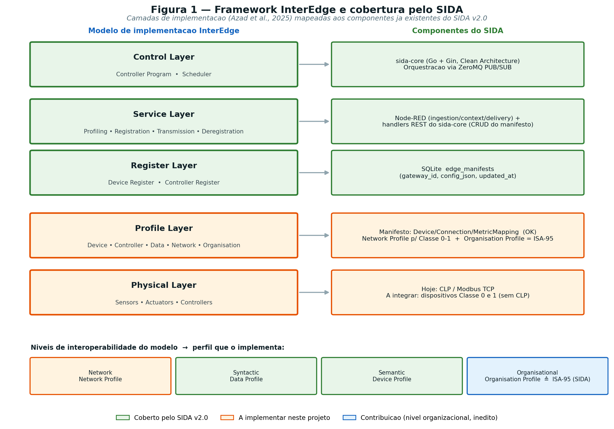
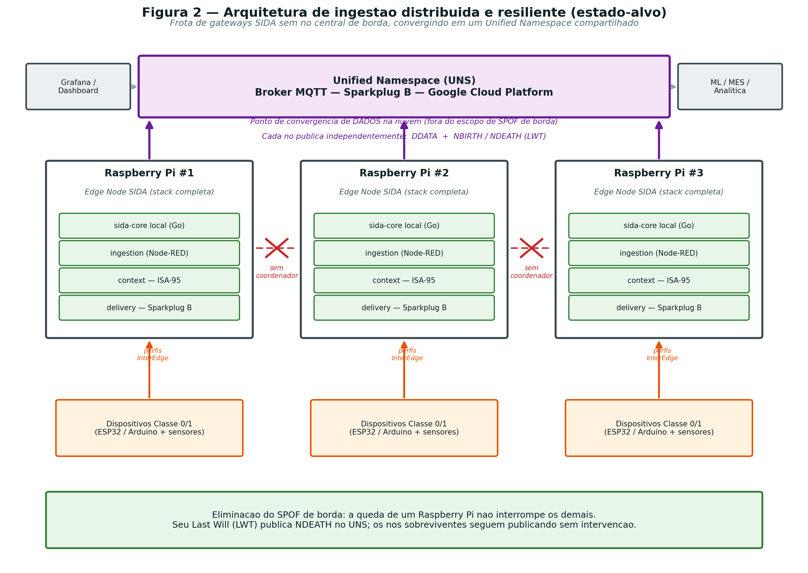
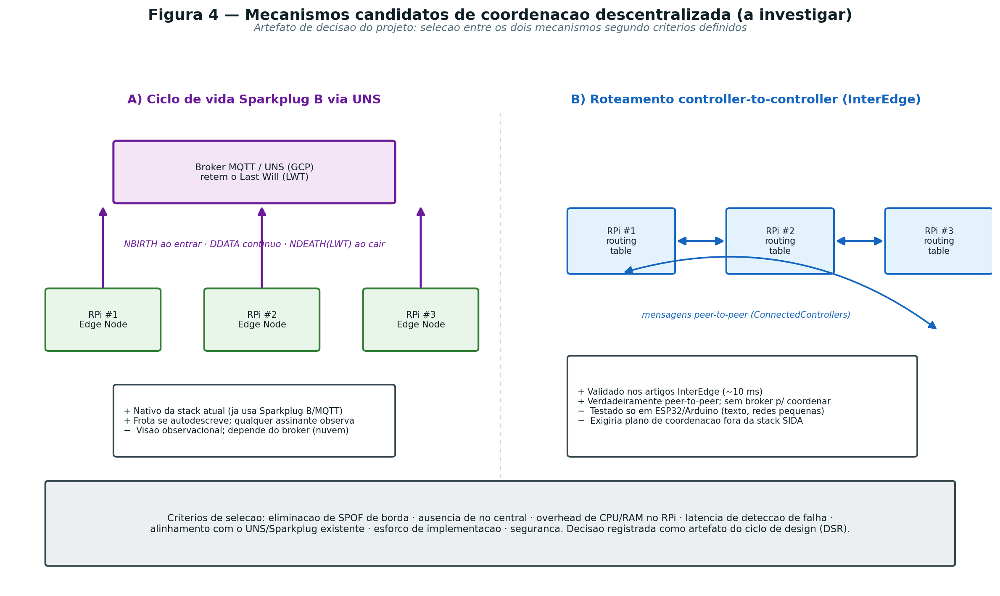
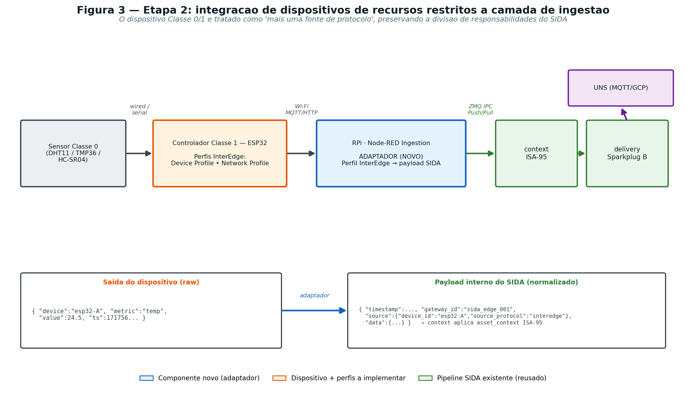
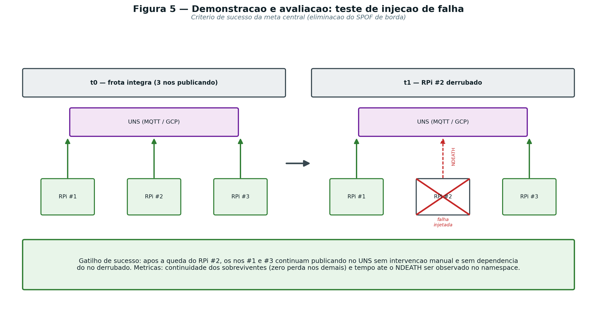

# Release Notes v3.0

*Data: 01 de julho de 2026*

---

## Ciclo de Distribuição da Borda, Resiliência e Interoperabilidade de Recursos Restritos

### Objetivo

A versão 3.0 do SIDA (Smart Industrial DataOps Agent) marca a transição da topologia **centralizada** validada na Release 2.0 para uma **arquitetura de ingestão distribuída e resiliente na borda**. O objetivo deste ciclo é eliminar o **ponto único de falha (SPOF)** da camada de borda, distribuindo o SIDA em uma **frota de gateways Raspberry Pi** que convergem em um Unified Namespace (UNS) compartilhado, **sem nó central de coordenação**, e ampliar a camada de ingestão para **dispositivos de recursos restritos (Classe 0 e 1)** em contextos industriais sem CLPs. A evolução é fundamentada no modelo de interoperabilidade hierárquico e descentralizado **InterEdge**.

### Contexto e motivação

A Release 2.0 comprovou a viabilidade do pipeline ponta a ponta (ingestão → contextualização ISA-95 → entrega Sparkplug B → UNS), mas deixou registradas duas limitações estruturais que este ciclo endereça: a coleta concentrada em um gateway único (SPOF de borda) e a ingestão restrita ao protocolo Modbus TCP. Adicionalmente, este ciclo materializa uma contribuição conceitual: posicionar o motor de contextualização ISA-95 do SIDA como a primeira realização concreta do **nível organizacional** do modelo InterEdge, até então não implementado.

### Fundamentação: mapeamento InterEdge × SIDA

A evolução parte da formalização de que os componentes já entregues do SIDA realizam, na prática, as camadas do framework InterEdge. Trata-se de um mapeamento — não de reimplementação —, no qual o nível organizacional (via ISA-95) figura como contribuição inédita.

*Figura 1 — Camadas do framework InterEdge e sua cobertura pelos componentes do SIDA v2.0.*

### Fundamentação: dois planos de coordenação (A + B)

A frota adota **dois mecanismos de coordenação simultâneos**, alocados em planos de comunicação distintos para operarem sem conflito:

- **Mecanismo A — Ciclo de vida Sparkplug B via UNS (plano norte, borda → nuvem):** cada gateway atua como um *Sparkplug Edge Node* independente, anunciando `NBIRTH` ao ingressar e `NDEATH` ao cair (via *Last Will and Testament*, LWT). A frota se autodescreve no namespace; qualquer assinante observa seu estado.
- **Mecanismo B — Roteamento *controller-to-controller* do InterEdge (plano leste-oeste, borda ↔ borda):** cada gateway mantém um registro de pares (`ConnectedControllers`) e realiza *probes* periódicos por uma malha ZeroMQ, detectando a queda de um par **localmente**, sem depender da nuvem. É a instanciação genuína do plano de controle descentralizado do InterEdge.

Os dois planos fornecem **sinais de liveness independentes** (observado da nuvem e observado entre pares), e o plano leste-oeste permanece operante mesmo diante de uma indisponibilidade do broker. A Figura 2 apresenta o estado-alvo da frota; a Figura 4 contrasta os dois mecanismos.

*Figura 2 — Arquitetura de ingestão distribuída e resiliente (estado-alvo): frota sem nó central de borda convergindo em um UNS compartilhado.*

*Figura 4 — Mecanismos de coordenação (A e B), adotados simultaneamente em planos distintos.*

---

## Stack Tecnológica

Para este ciclo, a stack da Release 2.0 é estendida com os componentes de distribuição, resiliência e interoperabilidade de recursos restritos:

| Tecnologia | Descrição |
|---|---|
| Raspberry Pi (ARM64) | Nós da frota de borda; cada um executa a pilha completa do SIDA. Compatibilidade ARM64 já validada. |
| Docker / Docker Compose | Orquestração multi-nó, parametrizada por nó (identidade, pares, broker) via `.env`. |
| Node-RED | Camada de **delivery** estendida para o ciclo de vida Sparkplug; camada de **ingestão** com o novo adaptador de dispositivos Classe 0/1. |
| Go / sida-core | Hospeda o **plano de coordenação peer-to-peer** (registro de pares, *probes*, roteamento) — instanciação InterEdge. |
| ZeroMQ | Malha leste-oeste entre os `sida-core` da frota (Mecanismo B), além do IPC interno já existente. |
| MQTT / Sparkplug B | Plano norte (Mecanismo A): ciclo `NBIRTH`/`DBIRTH`/`DDATA`/`NDEATH` + LWT no UNS. |
| ESP32 / Arduino | Controladores/sensores Classe 1 e 0, fontes de ingestão sem CLP. |
| Framework InterEdge | Perfis de dispositivo/rede e *controller register* que fundamentam o plano B e a ingestão da Etapa 2. |
| Broker MQTT / UNS (GCP) | Ponto de convergência de dados na nuvem (permanece central por design do UNS). |

---

## Estrutura das Provas de Conceito (PoCs)

O desenvolvimento é fatiado em cinco entregáveis isolados e verificáveis. Cada PoC possui critério de sucesso próprio.

| PoC | Descrição |
|---|---|
| **PoC 1 — Ciclo de vida Sparkplug B (Mecanismo A / plano norte)** | **Foco:** resiliência e observabilidade da frota via UNS. **Ação:** estender a delivery para emitir `NBIRTH`/`DBIRTH` na subida, manter `DDATA` com aliases e publicar `NDEATH` (gracioso e via LWT). **Valor:** cada gateway se autodescreve e sinaliza vida/morte no namespace. |
| **PoC 2 — Malha de coordenação peer-to-peer (Mecanismo B / plano leste-oeste)** | **Foco:** plano de controle descentralizado do InterEdge. **Ação:** implementar no sida-core o *controller register* (pares, `ConnectedControllers`), a malha ZeroMQ, o *scheduler* de *probes* e as primitivas de roteamento (`WriteMessage`/`RouteMessage`/`ReadMessage`). **Valor:** detecção de queda de par local, independente da nuvem. |
| **PoC 3 — Frota descentralizada sem SPOF de borda** | **Foco:** eliminação do ponto único de falha na borda. **Ação:** operar ≥ 3 Raspberry Pi, cada um com a stack completa, publicando de forma independente no UNS compartilhado, sem coordenador central. **Valor:** a queda de um nó não interrompe os demais. |
| **PoC 4 — Ingestão de dispositivos Classe 0/1 (Etapa 2)** | **Foco:** ampliação da camada de ingestão a fontes sem CLP. **Ação:** perfis InterEdge no ESP32; transporte leve (MQTT local/HTTP) ao RPi; adaptador Node-RED que normaliza a saída para o payload interno do SIDA. **Valor:** dispositivos de recursos restritos alimentam o pipeline e são contextualizados por ISA-95. |
| **PoC 5 — Demonstração de resiliência (injeção de falha)** | **Foco:** validação da meta central. **Ação:** derrubar um gateway da frota íntegra e observar o comportamento nos dois planos. **Valor:** comprova a eliminação do SPOF de borda com evidência mensurável. |

A Figura 3 detalha a PoC 4 (ingestão de dispositivos Classe 0/1) e a Figura 5, a PoC 5 (demonstração por injeção de falha).

*Figura 3 — Integração de dispositivos Classe 0/1 à camada de ingestão, tratados como "mais uma fonte de protocolo".*

*Figura 5 — Teste de injeção de falha: critério de sucesso da eliminação do SPOF de borda.*

---

## Critérios de Aceite

Para que cada PoC seja considerada concluída e validada para a integração final, deve cumprir os requisitos isolados abaixo.

### PoC 1 — Ciclo de vida Sparkplug B (plano norte)
- A delivery deve publicar `NBIRTH` (e `DBIRTH` por dispositivo, com aliases) ao conectar, mantendo a numeração `bdSeq`/`seq` conforme a especificação.
- O `DDATA` deve referenciar os aliases declarados no `DBIRTH`.
- O LWT deve estar registrado como `NDEATH`; a parada graciosa também deve emitir `NDEATH`.
- **Gatilho de Sucesso:** ao assinar `spBv1.0/#`, observa-se `NBIRTH`/`DBIRTH` na subida e `NDEATH` quando o nó é encerrado ou derrubado.

### PoC 2 — Malha de coordenação peer-to-peer (plano leste-oeste)
- Cada `sida-core` deve carregar seu *controller register* e estabelecer a malha ZeroMQ com os pares de `ConnectedControllers`.
- O *scheduler* deve executar *probes* periódicos e atualizar o estado de liveness dos pares.
- Uma mensagem deve rotear corretamente entre pares conforme a tabela de roteamento.
- **Gatilho de Sucesso:** ao derrubar um par, os demais detectam o *timeout* localmente dentro do intervalo configurado; o estado da malha é consultável via `GET /api/system/peers`.

### PoC 3 — Frota descentralizada sem SPOF de borda
- A mesma `docker-compose` deve subir em qualquer RPi mudando apenas o `.env` (identidade, pares, broker).
- Os ≥ 3 nós devem publicar simultaneamente no UNS e enxergar-se na malha.
- **Gatilho de Sucesso:** os três nós aparecem vivos nos dois planos (UNS e peer-mesh), sem nenhum nó exercendo papel de coordenador central.

### PoC 4 — Ingestão de dispositivos Classe 0/1
- O ESP32 deve publicar leituras via perfil InterEdge; o adaptador deve normalizá-las para o payload interno do SIDA (`timestamp`, `gateway_id`, `source.source_protocol = "interedge"`, `data`).
- O modelo `Connection` deve aceitar o protocolo `interedge`; o dispositivo deve ser mapeado na hierarquia ISA-95 via manifesto.
- **Gatilho de Sucesso:** a leitura do sensor percorre ingestão → contexto (ISA-95) → delivery e aparece contextualizada no UNS, no tópico `spBv1.0/{group}/DDATA/{line}/{equipment}`, sem CLP na origem.

### PoC 5 — Demonstração de resiliência (injeção de falha)
- Partindo da frota íntegra publicando no UNS, derruba-se deliberadamente um gateway.
- **Gatilho de Sucesso:** os nós sobreviventes continuam publicando **sem intervenção manual** e **sem dependência** do nó derrubado; observa-se o `NDEATH`/LWT no UNS (plano A) e o *timeout* do par no peer-mesh (plano B). Registram-se as métricas de continuidade (zero perda nos sobreviventes), tempo-até-`NDEATH`, tempo-até-detecção-de-par e *overhead* de CPU/RAM por nó.

---

## Escopo e Delimitações

Este ciclo elimina o SPOF **do plano de borda**. Permanecem **fora de escopo**, por decisão de projeto:

- O broker MQTT na nuvem como ponto de convergência de dados (inerente ao padrão UNS).
- O *store-and-forward* persistente com WAL para instabilidade entre gateway e nuvem (roadmap independente).
- A segurança criptográfica (TLS/mTLS) da malha e do IPC, e a evolução da autenticação (PIN → OAuth2).
- O controle/atuação local nos dispositivos Classe 0/1 — cujo papel se restringe ao sensoriamento.
- O *failover* de dados via par (reencaminhar dados de um nó isolado por um par com conectividade) é tratado como **extensão opcional**, não como núcleo da entrega.

---

## Cronograma

O ciclo é organizado segundo o método Design Science Research (DSR), com as implementações dos planos A e B em sequência antes da ingestão Classe 0/1 e da demonstração final. *(Períodos a definir.)*

| Etapa | Período | Descrição |
|---|---|---|
| Fundação e mapeamento |  | Baseline v2.0 na frota; identidades dos nós; mapeamento formal InterEdge × SIDA (E01). Compatibilidade ARM64 já validada. |
| Decisão de coordenação |  | Registro da adoção A + B e da separação de planos (E02). |
| Plano norte — Sparkplug |  | PoC 1: ciclo de vida `NBIRTH`/`NDEATH`/`DDATA` + LWT na delivery (E03). |
| Plano leste-oeste — peer-mesh |  | PoC 2: *controller register*, malha ZeroMQ, *probes* e roteamento no sida-core (E03). |
| Frota multi-RPi |  | PoC 3: orquestração parametrizada e UNS compartilhado nos ≥ 3 nós (E04). |
| Ingestão Classe 0/1 |  | PoC 4: perfis InterEdge, transporte e adaptador de ingestão (E05). |
| Demonstração e avaliação |  | PoC 5: injeção de falha, coleta de métricas e evidências; testes automatizados mínimos (E06). |
| Comunicação |  | Relatório técnico e artigo científico (E07). |

---

## Entregáveis do ciclo

Visão geral e, na sequência, o detalhamento de cada entregável.

| Cód. | Entregável |
|---|---|
| E01 | Mapeamento formal InterEdge × SIDA. |
| E02 | Relatório de decisão de coordenação (A + B) e separação de planos. |
| E03 | Implementação dos planos de coordenação: ciclo Sparkplug (A) e peer-mesh InterEdge (B). |
| E04 | Frota multi-Raspberry Pi configurada com UNS compartilhado. |
| E05 | Adaptador de ingestão para dispositivos Classe 0/1 (perfis InterEdge). |
| E06 | Relatório de demonstração e avaliação (teste de injeção de falha). |
| E07 | Artigo científico com os resultados do ciclo. |

### E01 — Mapeamento formal InterEdge × SIDA

- **Descrição:** artefato teórico que formaliza a correspondência entre as cinco camadas do framework de implementação InterEdge e os componentes já entregues do SIDA, demonstrando que se trata de mapeamento — e não de reimplementação.
- **Conteúdo:**
  - Tabela camada × componente: Control ↔ `sida-core` (Go, Clean Architecture); Service ↔ fluxos Node-RED + handlers REST; Register ↔ SQLite `edge_manifests`; Profile ↔ modelos `Device/Connection/MetricMapping`; Physical ↔ CLP/Modbus (hoje) e Classe 0/1 (a integrar).
  - Mapa nível → perfil do modelo (network → Network Profile; syntactic → Data Profile; semantic → Device Profile; **organisational → Organisation Profile ≙ ISA-95**).
  - Justificativa do nível organizacional como **contribuição inédita** (não implementado nos trabalhos originais do InterEdge).
  - Ressalva terminológica: "descentralizado" no InterEdge (sem dependência da nuvem para decisões de interoperabilidade) ≠ resiliência multi-gateway.
- **Formato:** documento técnico (Markdown/DOCX) acompanhado da Figura 1.
- **Critério de conclusão:** mapeamento revisado, coerente com os artigos do InterEdge, anexado ao relatório técnico.

### E02 — Relatório de decisão de coordenação (A + B) e separação de planos

- **Descrição:** artefato de decisão da DSR que justifica a adoção simultânea dos dois mecanismos de coordenação.
- **Conteúdo:**
  - Matriz de critérios: eliminação de SPOF de borda, ausência de nó central, *overhead* de CPU/RAM, latência de detecção de falha, alinhamento com UNS/Sparkplug, esforço de implementação e segurança.
  - Análise comparativa A × B e a fundamentação da adoção conjunta.
  - Definição da **separação de planos** (norte = MQTT/Sparkplug ao UNS; leste-oeste = ZeroMQ entre `sida-core`), com transportes e portas distintos, como garantia de não-conflito.
  - Descrição da sinergia de **duplo sinal de liveness** (LWT/`NDEATH` da nuvem + *timeout* de *probe* entre pares).
- **Formato:** documento técnico acompanhado da Figura 4.
- **Critério de conclusão:** decisão registrada, com os dois planos desenhados e o não-conflito demonstrado.

### E03 — Implementação dos planos de coordenação (A + B)

- **Descrição:** artefato de software central do ciclo; entrega os dois planos operacionais (PoCs 1 e 2).
- **Conteúdo — Plano A (delivery / Node-RED):**
  - Schema Sparkplug B em `schemas/sparkplug_b.proto` como fonte da verdade.
  - Gestão de `bdSeq`/`seq` no fluxo de delivery.
  - LWT registrado como `NDEATH`; publicação de `NBIRTH` e `DBIRTH` (com aliases) na subida; `DDATA` migrado para aliases; `NDEATH` gracioso no encerramento.
- **Conteúdo — Plano B (sida-core / Go):**
  - *Controller register* no domínio (novo modelo + tabela SQLite `controllers`): `ConnectedControllers`, `ControllerProbeIntervals`, `MessageBuffer`, roteamento.
  - Malha peer-to-peer via ZeroMQ (socket peer dedicado, distinto do PUB/SUB de manifesto em `:5556`).
  - *Scheduler* de *probes* (loop do `ControllerProgram`) com detecção de *timeout* de par.
  - Primitivas de transmissão do InterEdge (`WriteMessage`/`RouteMessage`/`ReadMessage`) e tabela de roteamento.
  - Endpoint `GET /api/system/peers` expondo o estado da malha.
- **Formato:** código versionado (Node-RED `flows.json` da delivery + módulos Go do sida-core) e schema em `/schemas`.
- **Critério de conclusão:** PoCs 1 e 2 aprovadas em seus respectivos gatilhos de sucesso.

### E04 — Frota multi-Raspberry Pi com UNS compartilhado

- **Descrição:** ambiente distribuído operacional (PoC 3).
- **Conteúdo:**
  - `docker-compose` parametrizado por `.env` (`EDGE_GATEWAY_ID`, `edge_node_id`, `group_id`, lista de pares, URL do broker, `EDGE_ENGINEER_PIN`).
  - ≥ 3 Raspberry Pi ARM64, cada um com a pilha completa do SIDA.
  - Rede do peer-mesh configurada (IPs fixos/hostnames e portas peer abertas entre os nós).
  - Tabela de identidades da frota documentada.
- **Formato:** infraestrutura (compose + *template* de `.env`) e README de implantação multi-RPi.
- **Critério de conclusão:** PoC 3 aprovada; os três nós ativos e visíveis nos dois planos.

### E05 — Adaptador de ingestão para dispositivos Classe 0/1

- **Descrição:** extensão da camada de ingestão a fontes sem CLP (PoC 4).
- **Conteúdo:**
  - Firmware do ESP32 (C/C++) com perfis InterEdge (*device profile* + *network profile*); encadeamento sensor Classe 0 → ESP32 (Classe 1) → RPi quando aplicável.
  - Transporte leve dispositivo → RPi (MQTT local ou HTTP), distinto do broker do UNS de saída.
  - Sub-fluxo **adaptador** em `core/ingestion/flows.json` que normaliza a saída do dispositivo para o payload interno do SIDA e injeta no socket ZMQ Push do contexto.
  - Extensão do enum `Connection.Protocol` em `manifest.go` com o valor `interedge`.
  - Mapeamento do dispositivo na hierarquia ISA-95 via manifesto (prova do nível organizacional para fonte sem CLP).
- **Formato:** firmware (C/C++), `flows.json` da ingestão e patch no `sida-core`.
- **Critério de conclusão:** PoC 4 aprovada; leitura do sensor contextualizada no UNS sem CLP na origem.

### E06 — Relatório de demonstração e avaliação

- **Descrição:** evidência mensurável da eliminação do SPOF de borda (PoC 5).
- **Conteúdo:**
  - Protocolo do teste de injeção de falha (cenário íntegro → queda de um gateway).
  - Resultados nos dois planos: `NDEATH`/LWT no UNS (A) e *timeout* de par no peer-mesh (B).
  - Métricas: continuidade dos sobreviventes (zero perda), tempo-até-`NDEATH`, tempo-até-detecção-de-par e *overhead* de CPU/RAM por nó.
  - Pacote de evidências (logs, capturas de `mosquitto_sub`, saídas de `GET /api/system/peers`).
  - Suíte mínima de testes automatizados (adaptador, *controller register*/peer-mesh e ciclo Sparkplug), suprindo limitação conhecida da v2.0.
- **Formato:** relatório técnico com anexos de evidência.
- **Critério de conclusão:** PoC 5 aprovada e métricas consolidadas.

### E07 — Artigo científico

- **Descrição:** comunicação dos resultados (etapa final da DSR).
- **Conteúdo:**
  - Fundamentação (InterEdge, UNS, ISA-95, Sparkplug B) e método (DSR).
  - Arquitetura A + B e o mapeamento InterEdge × SIDA, com destaque para a primeira realização do nível organizacional.
  - Resultados da demonstração de resiliência e discussão de escalabilidade e limitações.
- **Formato:** artigo em formato de conferência/periódico.
- **Critério de conclusão:** artigo submetido a ao menos um veículo científico.
